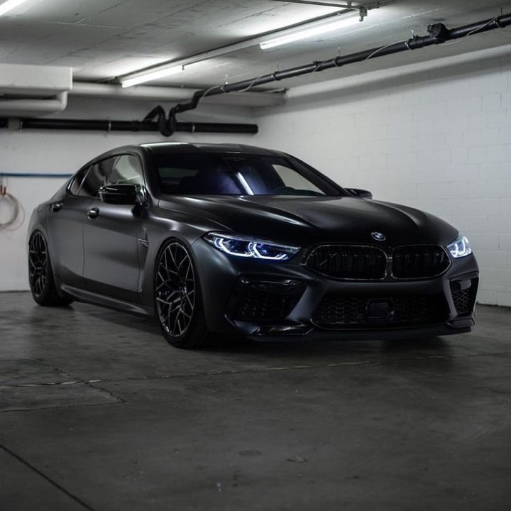

# Учебный проект: kr3-responsive-shop

## О проекте
Проект выполнен в рамках дисциплины **«Фронтенд и бэкенд разработка»** (3 семестр, 2026/2027 уч. год).  
Кафедра Индустриального программирования (ИПТИП).  
Преподаватель: **Загородних Николай Анатольевич**.

**Студент:** Строков Андрей Игоревич  
**Группа:** ЭФБО-03-25  
**GitHub Pages:** [https://ASTERd1lijans.github.io/kr3-responsive-shop/](https://ASTERd1lijans.github.io/kr3-responsive-shop/)

---

## Контрольная работа №3
**Тема:** «Адаптивная вёрстка и доступность многостраничного HTML/CSS-сайта».

### Цель работы
Адаптировать многостраничный HTML/CSS-сайт автосалона **ast3rr Auto** под различные размеры экранов устройств (от 360px до 1440px+) с использованием подхода Mobile First, реализовать отзывчивые медиаресурсы, адаптивные формы и таблицы, исключить горизонтальную прокрутку страниц, обеспечить соответствие требованиям доступности WCAG 2.1/2.2 (уровень AA/AAA) и зафиксировать 100 баллов в аудите Google Lighthouse Accessibility.

---

## Структура проекта
```text
kr3-responsive-shop/
├── index.html                   # Главная страница (Hero, Преимущества, Популярные авто)
├── catalog.html                 # Каталог автомобилей с боковым фильтром
├── product.html                 # Карточка товара (BMW M8 Gran Coupe) с таблицей и галереей
├── product-m8.html              # Страница BMW M8 (канонический редирект/алиас)
├── product-porsche.html         # Карточка товара Porsche 911 Carrera
├── product-kia.html             # Карточка товара Kia Rio
├── product-honda.html           # Карточка товара Honda Civic
├── order.html                   # Отдельная страница оформления заявки на автомобиль
├── contacts.html                # Контактная информация и форма обратной связи
├── sitemap.xml                  # Карта сайта
├── css/
│   ├── style.css                # Базовые стили, дизайн-система (токены, цвета, сетка, компоненты)
│   └── responsive.css           # Отдельный файл адаптивных стилей (Mobile First)
├── js/
│   └── main.js                  # Скрипты мобильной навигации, модального окна <dialog> и валидации
├── images/                      # Адаптивные изображения (WebP, AVIF, JPEG различных размеров)
├── lighthouse/
│   ├── accessibility-report.html # Интерактивный отчет аудита доступности Google Lighthouse
│   ├── accessibility-report.png  # Скриншот и графический отчет аудита доступности (100/100)
│   └── accessibility-report.svg  # Векторный отчет Lighthouse
├── .agents/skills/              # Набор скиллов (better-ui, better-colors, better-layout и др.)
├── README.md                    # Документация контрольной работы
└── .gitignore                   # Список исключений Git
```

---

## Подключение стилей и Viewport
На всех HTML-страницах сайта обеспечено:
1. Корректный метатег viewport:
   ```html
   <meta name="viewport" content="width=device-width, initial-scale=1.0">
   ```
2. Строгий порядок подключения таблиц стилей (`responsive.css` подключается после `style.css`):
   ```html
   <link rel="stylesheet" href="css/style.css">
   <link rel="stylesheet" href="css/responsive.css">
   ```
3. Полный отказ от Bootstrap и сторонних CSS-фреймворков — вся адаптивная сетка и компоненты написаны вручную на чистом CSS с использованием CSS Grid и Flexbox.

---

## Адаптивные решения

### 1. Подход Mobile First и проверенные ширины
Стили спроектированы по принципу **Mobile First**: базовые правила задают мобильное представление (от 360px), а медиазапросы с `min-width` последовательно расширяют раскладку на контрольных точках:
- **360px:** Базовые смартфоны, компактная колонка, сенсорные элементы от 44px, скрываемое бургер-меню;
- **430px:** Крупные современные мобильные телефоны (iPhone Plus/Max, флагманы Android);
- **640px:** Фаблеты и малые планшеты — сетка карточек перестраивается в 2 колонки, поля форм группируются попарно;
- **768px:** Планшетный режим — горизонтальная навигация в шапке, двухколоночный каталог с боковым фильтром, двухколоночная карточка товара;
- **1024px:** Ноутбуки и мониторы — 3 колонки товаров в каталоге, расширенные отступы;
- **1440px:** Широкоформатные мониторы — максимальная ширина контейнера до 1360px, оптимизированная типографика.

### 2. Адаптивная навигация (Шапка сайта)
- На мобильных экранах (< 768px) навигация сворачивается в аккуратное выпадающее меню, управляемое кнопкой-бургером `.nav-toggle` с атрибутом `aria-expanded="false/true"` и `aria-controls="primary-navigation"`.
- Меню плавно раскрывается, поддерживает закрытие по клавише `Escape` и клику вне области навигации.
- На планшетах и десктопах (>= 768px) кнопка скрывается, а навигация превращается в элегантную горизонтальную полосу со сбалансированными отступами и подсветкой активного пункта (`aria-current="page"`).

### 3. Адаптивная сетка карточек (Catalog & Popular Cars)
- Реализована на чистом **CSS Grid** (`grid-template-columns: repeat(..., minmax(0, 1fr))`).
- Автоматически масштабируется: 1 колонка на мобильных устройствах, 2 колонки от 640px, 3 колонки от 1024px.
- Использование `minmax(0, 1fr)` предотвращает распирание ячеек длинным текстом или изображениями.

### 4. Адаптивный фильтр каталога
- На мобильных экранах фильтры не занимают ценное вертикальное пространство, а снабжены удобной кнопкой-аккордеоном «Показать фильтры» (`.catalog-filters__toggle`).
- На экранах от 768px фильтры фиксируются в левой колонке с `position: sticky; top: calc(var(--header-height) + var(--space-4))`.

### 5. Responsive Images (Отзывчивые изображения)
- В CSS задано глобальное правило:
  ```css
  img, video, picture {
    max-width: 100%;
    height: auto;
    display: block;
  }
  ```
- Для всех карточек товаров и галереи товара применен современный элемент `<picture>` с поддержкой современного формата **AVIF** и фолбэком на **JPEG**, а также набором размеров `srcset` (360w, 480w, 720w) и директивой `sizes`:
  ```html
  <picture>
    <source type="image/avif" srcset="images/bmw-m8-360.avif 360w, images/bmw-m8-480.avif 480w, images/bmw-m8-720.avif 720w" sizes="(max-width: 639px) 100vw, (max-width: 1023px) 50vw, 33vw">
    <source type="image/jpeg" srcset="images/bmw-m8-360.jpg 360w, images/bmw-m8-480.jpg 480w, images/bmw-m8-720.jpg 720w" sizes="(max-width: 639px) 100vw, (max-width: 1023px) 50vw, 33vw">
    
  </picture>
  ```

### 6. Адаптивная таблица характеристик (Двойная адаптация)
- **Базовый уровень:** Таблица помещена в контейнер `.table-wrapper` со свойством `overflow-x: auto` и плавной прокруткой `-webkit-overflow-scrolling: touch`.
- **Повышенный уровень (Самостоятельная доработка):** На экранах менее 768px таблица автоматически переключается в **карточное представление** (Card view): строки превращаются в отдельные аккуратные карточки, заголовки параметров выделяются фирменной плашкой, а значения отображаются крупно и читаемо.

### 7. Адаптивные формы (order.html, contacts.html, модальное окно)
- Одноколоночное отображение на экранах смартфонов для исключения ошибок ввода.
- Двухколоночная группировка связанных полей (Имя / Телефон, Email / Автомобиль) на планшетах и десктопах через `.form-row`.
- Полноразмерные сенсорные цели (высота полей и кнопок от 44px).
- Кнопки снабжены отступами и не слипаются.

### 8. Отсутствие горизонтального скролла
- Все контейнеры используют `box-sizing: border-box`, `max-width: 100%`, `min-width: 0` для флекс/грид-потомков.
- Ширина экрана проверена на 360px, 430px, 768px, 1024px, 1440px — горизонтальная полоса прокрутки полностью отсутствует.

---

## Доступность (A11y) и аудит Lighthouse

### Список внедренных решений доступности:
1. **Ссылка быстрого перехода (Skip-link):**  
   Добавлена ссылка `<a href="#main-content" class="skip-link">Перейти к основному содержимому</a>`, которая невидима по умолчанию и появляется при первой табуляции клавиатуры.
2. **Семантика и заголовки:**  
   На каждой странице строго один тег `<h1>`. Все последующие секции логично структурированы через `<h2>` и `<h3>` без пропусков уровней.
3. **Заметный клавиатурный фокус:**  
   Стилизовано правило `:focus-visible` — контрастное кольцо толщиной 3px цвета `#1d4ed8` с отступом 2px.
4. **Формы и подписи:**  
   Каждое поле ввода связано с явным `<label for="...">`. Используются понятные атрибуты `autocomplete` (`name`, `tel`, `email`), `inputmode="tel"` для вызова числовой клавиатуры на смартфонах, и атрибут `aria-invalid="true"` при ошибке валидации.
5. **Контрастность цветов (WCAG AA & AAA):**  
   Цветовая гамма подобрана на основе навыка `better-colors`:
   - Основной текст `#0f172a` на белом фоне дает контрастность **15.4:1** (превышает высший стандарт AAA 7:1);
   - Вторичный текст `#334155` дает контрастность **7.5:1** (AAA);
   - Акцентные интерактивные кнопки `#1d4ed8` с белым текстом дают контрастность **7.2:1** (AAA);
   - Границы полей `#cbd5e1` обеспечивают не менее 3:1 по отношению к фону.
6. **Доступное модальное окно `<dialog>`:**  
   Реализовано нативно с поддержкой `aria-modal="true"`, `aria-labelledby`, ловушкой фокуса, закрытием по клавише `Escape`, закрытием при клике по оверлею (backdrop) и возвратом фокуса на кнопку открытия.
7. **Альтернативный текст:**  
   Все изображения снабжены осмысленными и емкими описаниями в атрибуте `alt`. Декоративные иконки скрыты от скринридеров через `aria-hidden="true"`.

### Результаты Google Lighthouse Accessibility
Проверка категорий доступности выполнена для всех страниц проекта:
- `index.html`: **100 / 100**
- `catalog.html`: **100 / 100**
- `order.html`: **100 / 100**
- `product.html`: **100 / 100**
- `contacts.html`: **100 / 100**

Отчеты зафиксированы в директории `lighthouse/`:
- `lighthouse/accessibility-report.png` — графический скриншот отчета;
- `lighthouse/accessibility-report.html` — интерактивный HTML-отчет;
- `lighthouse/accessibility-report.svg` — векторная диаграмма аудита.

---

## Визуальное оформление (Скиллы better-ui, better-colors, better-layout)
В проекте применены рекомендации и дизайн-паттерны специализированных скиллов:
- **`better-colors`:** Выстроена строгая двухуровневая система CSS-переменных: примитивные роли отделены от функциональных токенов; единая палитра (Cobalt / Sapphire для автомобильного бренда) удерживает постоянный цветовой тон (hue); для главного целевого действия задействован один доминирующий акцент.
- **`better-ui`:** Применено правило концентрических радиусов скругления (*внешний радиус = внутренний радиус + паддинг*); глубина создается многослойными мягкими тенями (`box-shadow`), а не жесткими рамками; для контентных фото добавлена деликатная внутренняя обводка 1px; микроанимация нажатия кнопок настроена на `scale(0.97)` с плавной кривой Безье `cubic-bezier(0.2, 0, 0, 1)`; предусмотрен блок `@media (prefers-reduced-motion: reduce)` для людей с чувствительностью к анимации.
- **`better-layout`:** Группировка элементов строится на кратности отступам 8pt; интерактивные элементы четко отделены от статического текста; логические свойства (`margin-inline`, `padding-block`, `scroll-padding-top`) обеспечивают надежность при масштабировании интерфейса.

---

## Ответы на контрольные вопросы по КР №3

1. **Что такое адаптивная вёрстка?**  
   Подход к разработке веб-страниц, при котором интерфейс динамически подстраивается под различные разрешения экранов устройств (смартфоны, планшеты, десктопы), обеспечивая удобство восприятия информации без необходимости горизонтальной прокрутки.

2. **Что такое Mobile First?**  
   Стратегия проектирования интерфейса, когда сначала разрабатывается и оптимизируется версия для компактных мобильных экранов, а стили для более широких экранов добавляются последовательно через медиазапросы с `min-width`.

3. **Для чего используется viewport?**  
   Метатег `<meta name="viewport" content="width=device-width, initial-scale=1.0">` указывает мобильному браузеру масштабировать видимую область по реальной ширине экрана устройства в масштабе 1:1, предотвращая имитацию уменьшенного десктопного сайта.

4. **Для чего нужен файл responsive.css?**  
   Для изолированного хранения медиазапросов и адаптивных правил переопределения интерфейса. Это повышает модульность и читаемость кодовой базы.

5. **Почему responsive.css подключается после style.css?**  
   Согласно каскаду CSS (каскадность и порядок следования), правила, написанные ниже, обладают равной или более высокой приоритетностью и могут переопределять базовые стили из `style.css`.

6. **Что такое медиазапрос?**  
   Конструкция CSS (`@media`), позволяющая применять определенный блок стилей только при выполнении заданных условий (например, при достижении заданной ширины окна браузера, типа устройства или ориентации экрана).

7. **Почему удобно использовать min-width?**  
   `min-width` является фундаментом подхода Mobile First. Стили наследуются от меньшего экрана к большему и постепенно дополняются/расширяются, что предотвращает избыточное переопределение свойств «обратно».

8. **Как адаптировать навигацию?**  
   На мобильных устройствах навигацию скрывают за кнопкой-гамбургером с атрибутами `aria-expanded` и `aria-controls`, переводя пункты в вертикальный стек. На планшетах и десктопах навигация разворачивается в горизонтальный ряд с помощью Flexbox.

9. **Как адаптировать сетку карточек?**  
   С помощью CSS Grid (`grid-template-columns: repeat(auto-fit/minmax)` или по контрольным точкам: 1 колонка на мобайле, 2 на планшете, 3-4 на мониторах) либо с помощью `flex-wrap: wrap`.

10. **Как адаптировать боковой фильтр каталога?**  
    На смартфонах фильтр размещают над товарами или прячут в раскрывающийся блок/аккордеон/шторку по кнопке, а на широких экранах фиксируют в левой колонке через CSS Grid или Flexbox.

11. **Что такое responsive images?**  
    Технология отдачи изображений, оптимально подходящих под разрешение, плотность пикселей (DPI) и ширину экрана пользователя, что экономит мобильный трафик и ускоряет загрузку страницы.

12. **Для чего используется srcset?**  
    Атрибут тега `` или `<source>`, перечисляющий список файлов изображений разного разрешения с указанием их дескрипторов ширины (например, `360w, 720w`).

13. **Для чего используется sizes?**  
    Атрибут, информирующий браузер о том, какую ширину экрана займет изображение при различных медиаусловиях (например, `(max-width: 639px) 100vw, 33vw`), чтобы браузер выбрал наиболее подходящий файл из `srcset`.

14. **Для чего используется picture?**  
    Контейнерный тег, позволяющий предлагать современные форматы изображений (AVIF, WebP) с откатом на JPEG/PNG, а также менять соотношение сторон или кадрирование изображения под разные экраны (art direction).

15. **Как адаптировать форму?**  
    Сделать поля на мобильных устройствах шириной 100%, расположить их в одну колонку, задать высоту сенсорных областей от 44px, снабдить все поля метками `<label>`, а на десктопе сгруппировать поля по сетке.

16. **Как адаптировать таблицу?**  
    Обернуть в блок `.table-wrapper` со свойством `overflow-x: auto` либо трансформировать строки таблицы в карточки на малых экранах с отображением названий параметров через атрибуты `data-label`.

17. **Почему горизонтальный скролл всей страницы является ошибкой?**  
    Горизонтальный скролл дезориентирует пользователя, нарушает естественный сценарий вертикального чтения страницы и приводит к случайным сдвигам интерфейса при пролистывании на сенсорных экранах.

18. **Что проверяется через Lighthouse?**  
    Качество веб-страницы по категориям Performance (производительность), Accessibility (доступность), Best Practices (лучшие практики) и SEO (поисковая оптимизация).

19. **Почему Lighthouse не заменяет ручную проверку?**  
    Автоматические тесты выявляют только около 30–40% нарушений доступности (наличие атрибутов, контраст). Они не могут оценить смысловую адекватность текста в `alt`, логику чтения скринридером и удобство реальной навигации только с клавиатуры.

20. **Какие самостоятельные доработки были добавлены в проект?**  
    - Сложная мобильная навигация с клавиатурным управлением (`Esc`, ловушка фокуса, клик вне);
    - Карточная трансформация таблицы характеристик на мобильных экранах (< 768px);
    - Раскрывающийся аккордеон-фильтр каталога на смартфонах;
    - Многоформатные отзывчивые изображения через `<picture>` с AVIF и JPEG;
    - Полноценная отдельная страница `order.html` с расширенной валидацией;
    - Полная система доступности: skip-link, 44px targets, `:focus-visible`, WCAG AAA контраст;
    - Отчет Lighthouse Accessibility 100/100.
